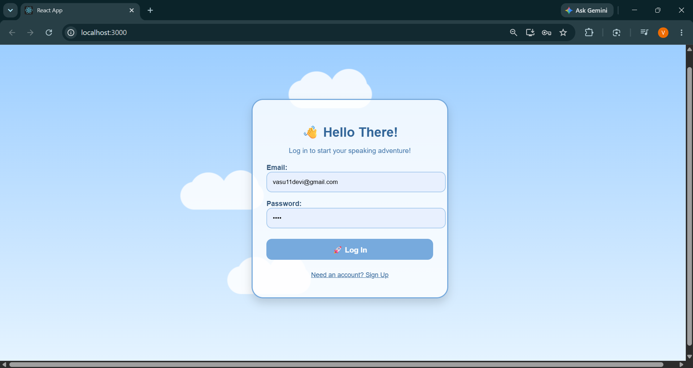
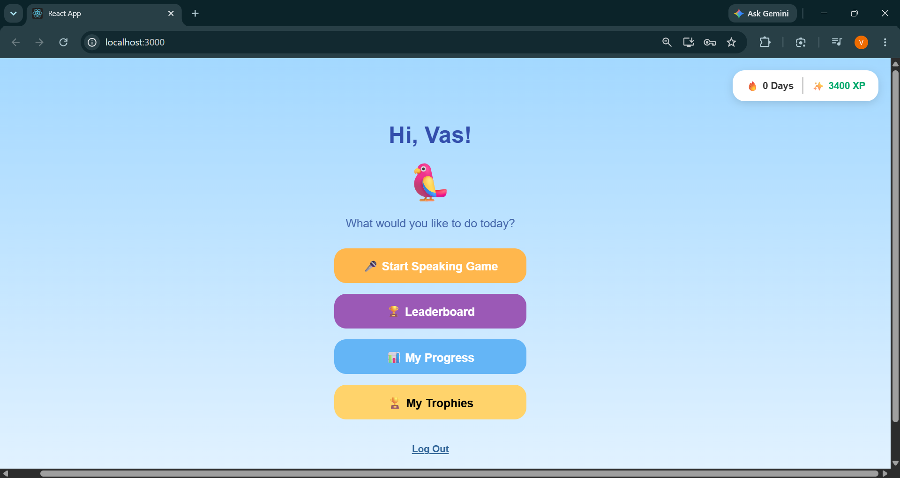
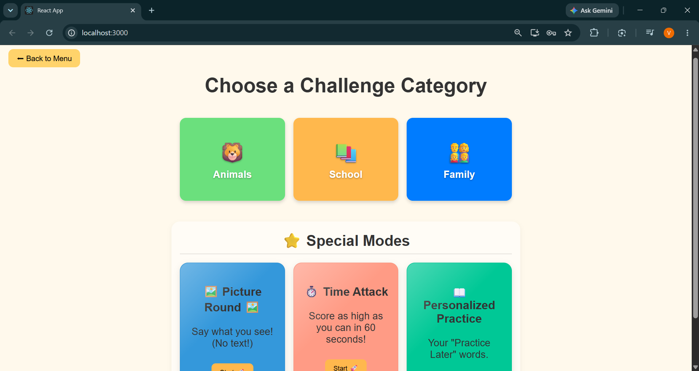
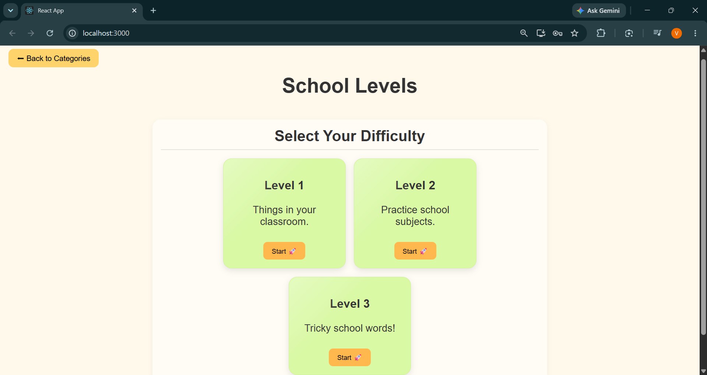
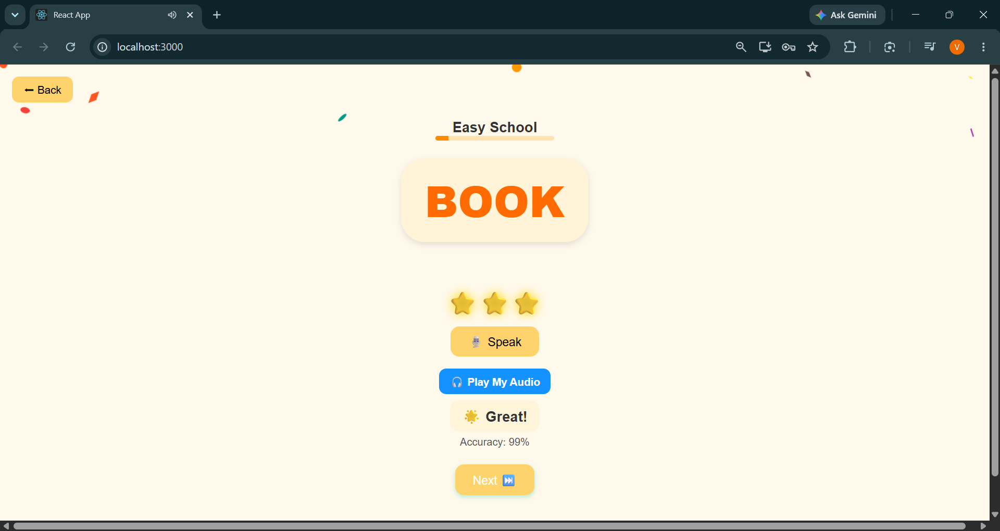
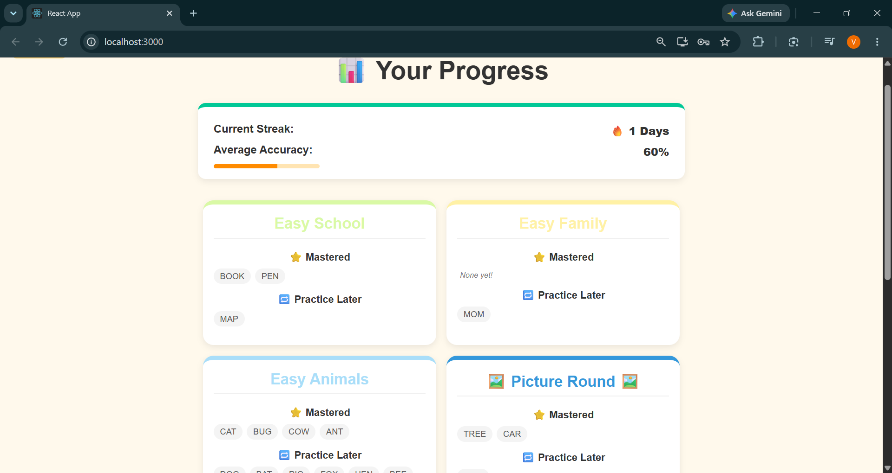
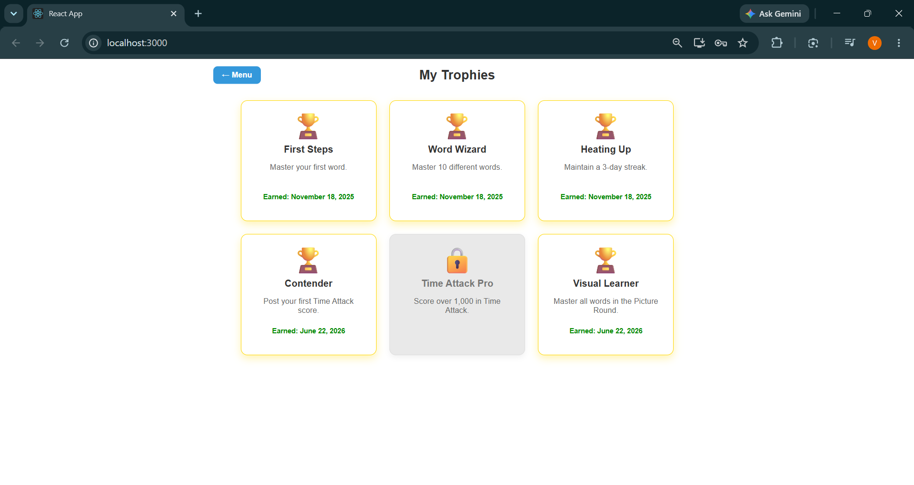
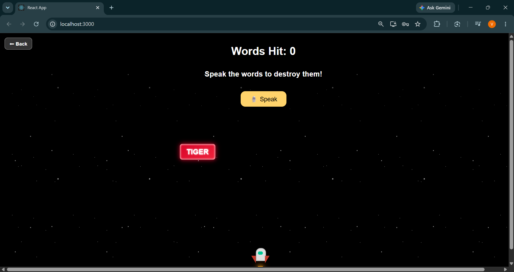

# Vocalis


  <b>Voice-Powered Speech Therapy & Language Learning Platform</b><br>
  An interactive full-stack web application that provides real-time pronunciation feedback, gamified learning experiences, and personalized speech practice.


<p align="center">


</p>

---

#  Overview

Vocalis is a full-stack speech therapy and language practice platform designed to help users improve pronunciation through real-time speech recognition and interactive learning activities.

The platform combines speech analysis, personalized practice, progress tracking, and gamification to create an engaging environment for learners of all ages.

---

#  Features

-  Real-time speech recognition using the Deepgram Speech-to-Text API
-  Instant pronunciation feedback
-  Gamified learning modules
  - Alphabets
  - Words
  - Sentences
  - Picture Round
  - Spaceship Revision
-  Personalized progress tracking
-  User leaderboard
-  Secure user authentication using JWT
-  Password encryption using bcryptjs
-  Customizable user avatars
-  Responsive user interface

---

# 🛠 Tech Stack

## Frontend

- React.js
- Framer Motion
- Axios
- CSS Modules

## Backend

- Node.js
- Express.js
- Formidable

## Database

- MongoDB
- Mongoose

## Authentication

- JSON Web Tokens (JWT)
- bcryptjs

## APIs

- Deepgram Speech-to-Text API

---

#  System Architecture

```
                +----------------------+
                |        User          |
                +----------+-----------+
                           |
                           |
                    React Frontend
                           |
                 Axios HTTP Requests
                           |
                    Express.js Server
                    /       |        \
                   /        |         \
          Authentication  Speech API  Progress
               |              |           |
             JWT         Deepgram API   MongoDB
                   \        |         /
                    \       |        /
                     +------v-------+
                     |   MongoDB    |
                     +--------------+
```

---

#  Project Structure

```
Vocalis
│
├── client/
│   ├── src/
│   ├── public/
│   └── package.json
│
├── server/
│   ├── routes/
│   ├── controllers/
│   ├── middleware/
│   ├── models/
│   ├── config/
│   └── package.json
│
├── README.md
└── .env
```

---

#  Getting Started

## Prerequisites

Make sure you have installed:

- Node.js
- npm
- MongoDB

---

## Clone the Repository

```bash
git clone https://github.com/Vasundhara117/Vocalis.git

cd Vocalis
```

---

## Install Dependencies

### Frontend

```bash
cd client
npm install
```

### Backend

```bash
cd ../server
npm install
```

---

## Environment Variables

Create a `.env` file inside the backend directory.

```env
DEEPGRAM_API_KEY=your_deepgram_api_key

MONGODB_URI=your_mongodb_connection_string

JWT_SECRET=your_secret_key

PORT=5000
```

---

## Run the Application

### Start Backend

```bash
npm run dev
```

### Start Frontend

```bash
npm start
```

---

Open your browser at

```
http://localhost:3000
```

---

#  API Routes

| Method | Endpoint | Description |
|----------|-------------------------|------------------------------------|
| POST | `/api/auth/register` | Register a new user |
| POST | `/api/auth/login` | User login |
| POST | `/api/check-speech` | Analyze speech input |
| GET | `/api/progress` | Fetch user progress |
| POST | `/api/progress` | Update learning progress |
| GET | `/api/leaderboard` | Retrieve leaderboard |
| GET | `/api/profile` | Fetch user profile |

---

#  Workflow

```
User Speech
      │
      ▼
Audio Upload
      │
      ▼
Express Backend
      │
      ▼
Deepgram Speech API
      │
      ▼
Speech Analysis
      │
      ▼
Pronunciation Feedback
      │
      ▼
Progress Stored in MongoDB
      │
      ▼
Leaderboard & User Dashboard
```

---

#  Screenshots

### Login


### Dashboard


### Practice Categories


### Levels


### Speech Challenge


### Progress Tracking


### Achievements


### Space Revision Game


---

#  Future Enhancements

- Enhanced speech analytics
- Additional language support
- Mobile application
- Cloud deployment
- AI-powered personalized learning recommendations

---

#  License

This project is licensed under the MIT License.

---

#  Author

**Vasundhara Devi Gubbala**

GitHub: https://github.com/Vasundhara117

LinkedIn: https://www.linkedin.com/in/vasundhara-devi/

**Sahasra Reddy Tekula**

GitHub: https://github.com/sahasra-tekula

LinkedIn: https://www.linkedin.com/in/tekula-sahasra-reddy-a642b6380/

---

